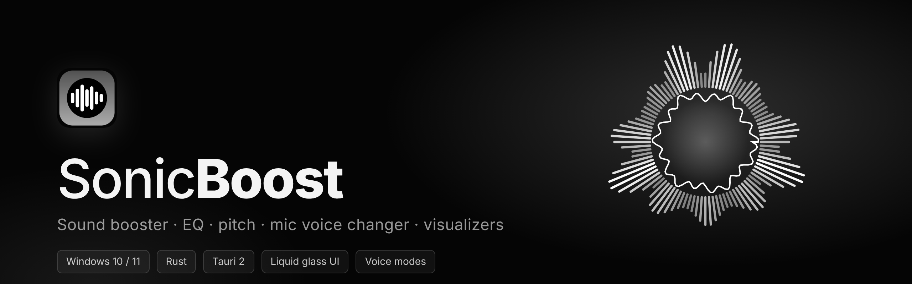
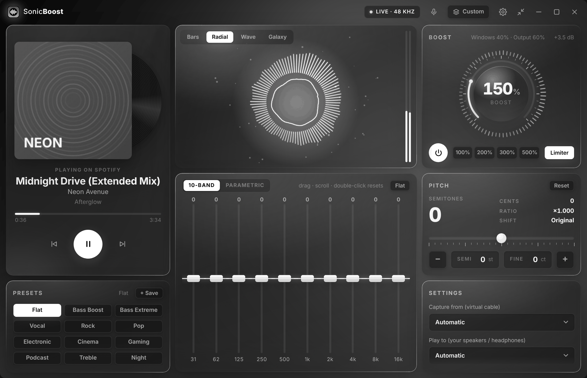
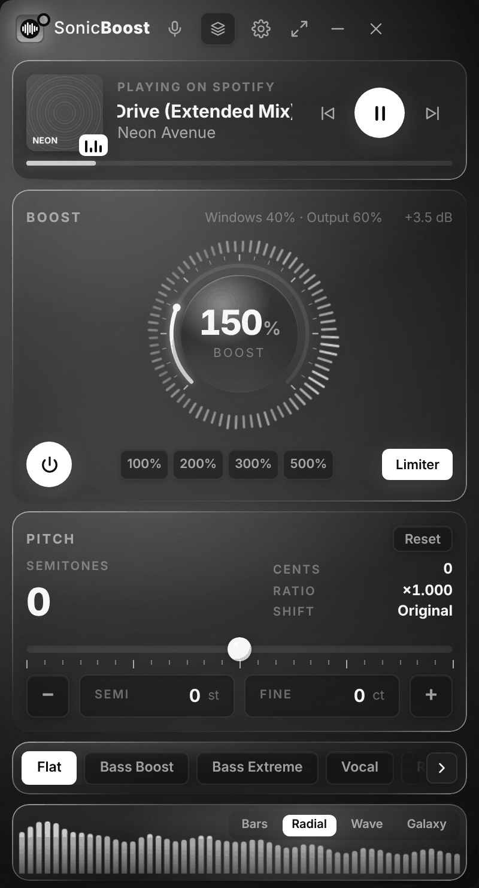
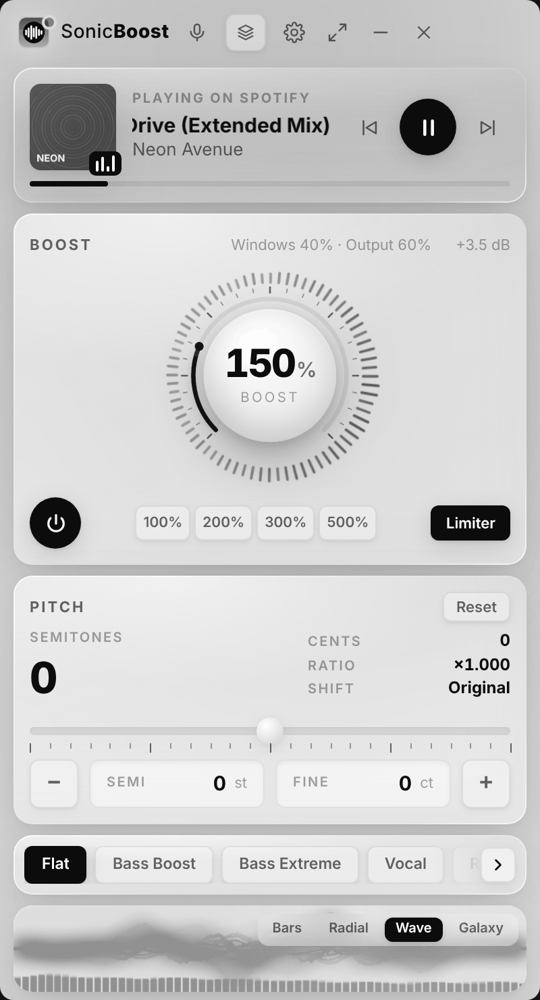
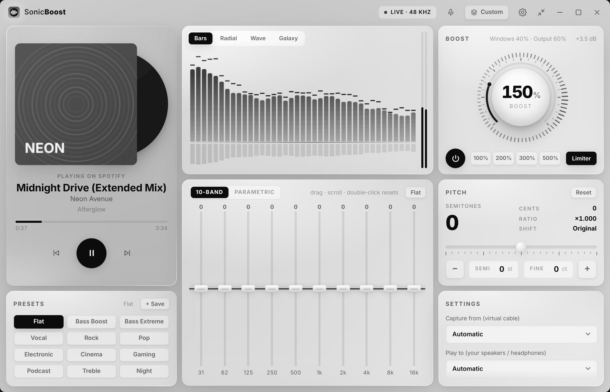
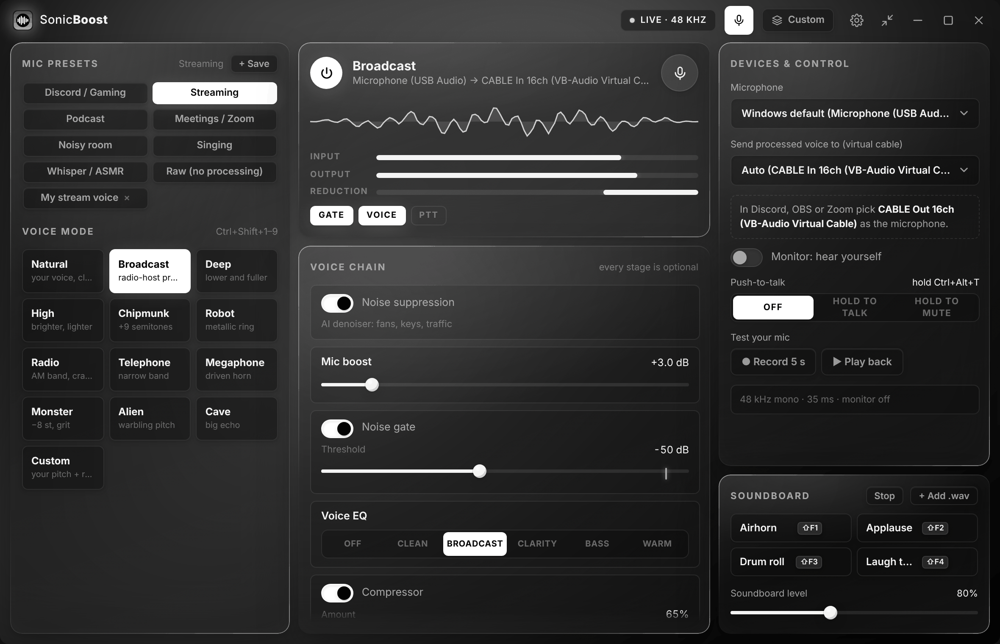
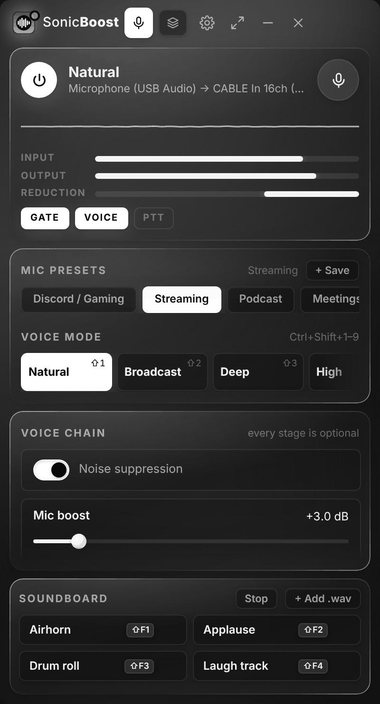
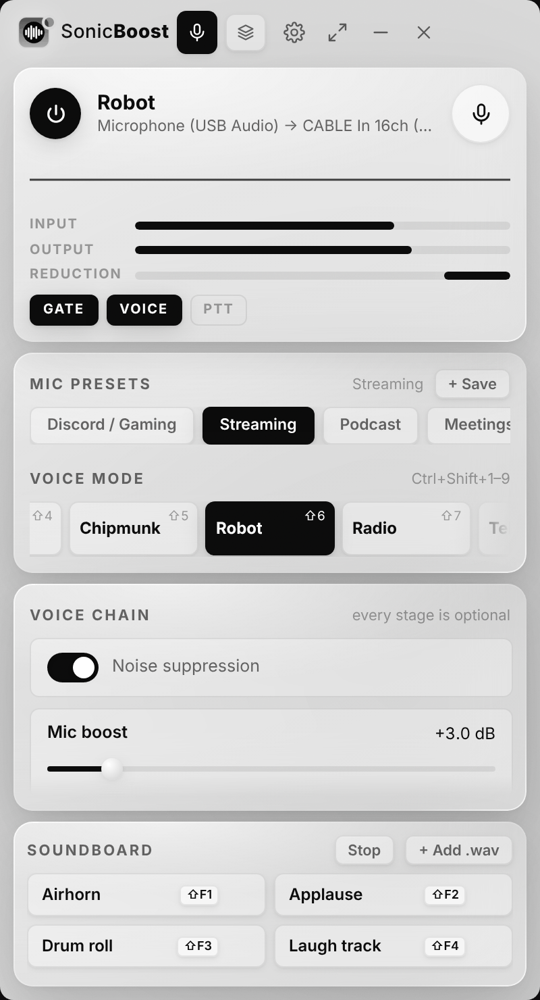
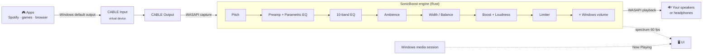

<div align="center">



<br />

**Make every sound on Windows louder, clearer and yours.**<br />
A system-wide sound booster with a 10-band and parametric equalizer, real-time pitch shifting, a mic processor with voice modes and a soundboard, a Now Playing panel and live visualizers, wrapped in a monochrome liquid-glass interface.

<br />

[](https://github.com/fr4gout/SonicBoost/actions/workflows/build-windows.yml)
[](https://github.com/fr4gout/SonicBoost/releases/latest)
[](#-system-requirements)
[](src-tauri/src)
[](https://tauri.app)
[](LICENSE)

[**Download**](https://github.com/fr4gout/SonicBoost/releases/latest) ·
[Features](#-features) ·
[Mic](#%EF%B8%8F-sonicboost-mic) ·
[Setup](#-installation) ·
[Hotkeys](#%EF%B8%8F-global-hotkeys) ·
[Build](#%EF%B8%8F-building-from-source) ·
[Architecture](docs/ARCHITECTURE.md)

</div>

<br />

<p align="center">
  
</p>

---

## Table of contents

- [Highlights](#-highlights)
- [Screenshots](#-screenshots)
- [Features](#-features)
- [SonicBoost Mic](#%EF%B8%8F-sonicboost-mic)
- [How it works](#-how-it-works)
- [System requirements](#-system-requirements)
- [Installation](#-installation)
- [Usage](#%EF%B8%8F-usage)
- [Global hotkeys](#%EF%B8%8F-global-hotkeys)
- [Building from source](#%EF%B8%8F-building-from-source)
- [Project structure](#%EF%B8%8F-project-structure)
- [Performance](#-performance)
- [Troubleshooting](#-troubleshooting)
- [FAQ](#-faq)
- [Roadmap](#%EF%B8%8F-roadmap)
- [Contributing](#-contributing)
- [License](#-license)

---

## ✦ Highlights

| | |
|:--|:--|
| 🔊 **Up to 600 % boost** | Up to +15.6 dB on all system audio, with a built-in limiter so it stays clean. |
| 🎚️ **10-band equalizer** | 31 Hz – 16 kHz, ±12 dB, a live response curve and 12 presets. You can save your own. |
| 🎛️ **Parametric EQ** | Equalizer APO-style: a preamp and up to 20 filters (PK, shelves, LP/HP, notch, BP) with draggable curve points. Imports and exports APO / AutoEQ configs. |
| 🗂️ **Sound profiles** | Save your whole sound and switch it system-wide from the title bar, the tray, or <kbd>Ctrl</kbd>+<kbd>Alt</kbd>+<kbd>1–9</kbd>. |
| 🎵 **Pitch shifter** | ±12 semitones plus ±100 cents. Speed stays the same and latency is low. |
| 🎙️ **Mic processor** | Noise suppression, gate, voice EQ, compressor, de-esser and limiter for Discord, OBS and Zoom. 8 mic presets. Every stage is optional. |
| 🎭 **Voice modes** | Deep, High, Chipmunk, Robot, Radio, Telephone, Megaphone, Monster, Alien, Cave and Custom, with hotkeys. |
| 📣 **Soundboard** | Play .wav clips into your mic for everyone in the call to hear, with hotkeys. |
| 💿 **Now Playing** | Title, artist and album art for Spotify, YouTube, Media Player and more, with playback controls. |
| 🌌 **Live visualizers** | Bars, Radial, Wave and Galaxy, driven by the real output spectrum. |
| 🧊 **Liquid-glass UI** | Monochrome, dark and light themes, spring-based motion, compact and extended layouts. |
| 🔊 **Windows volume sync** | The taskbar slider, volume keys and mute keep working through the cable. Output = boosted sound × Windows volume. |
| 🌊 **Ambience** | Echo and room effect, so Equalizer APO reverb/echo scripts work too. |
| 🔄 **Auto-updates** | Checks GitHub Releases and updates itself in one click, keeping your settings. |
| ⚡ **Lightweight** | Rust audio engine. Runs from the tray, starts with Windows, about 1 % CPU while hidden. |

---

## 📸 Screenshots

<table>
  <tr>
    <td align="center" width="50%"><br /><sub><b>Compact</b> · dark</sub></td>
    <td align="center" width="50%"><br /><sub><b>Compact</b> · light</sub></td>
  </tr>
  <tr>
    <td colspan="2" align="center"><br /><sub><b>Extended</b> · light, Bars visualizer</sub></td>
  </tr>
  <tr>
    <td colspan="2" align="center"><br /><sub><b>Mic</b> · presets, voice modes, voice chain, soundboard</sub></td>
  </tr>
  <tr>
    <td align="center" width="50%"><br /><sub><b>Mic</b> · compact</sub></td>
    <td align="center" width="50%"><br /><sub><b>Mic</b> · compact, light</sub></td>
  </tr>
</table>

---

## 🧩 Features

### Audio

| Feature | Details |
|:--|:--|
| **Boost** | 0 – 600 % on a spring-animated knob. Quick steps at 100 / 200 / 300 / 500 %. Drag, scroll, use the arrow keys, or double-click to reset. |
| **Loudness engine** | A loudness compressor that scales with the boost, followed by a 5 ms look-ahead peak limiter and a soft clip. Already-loud music gets clearly louder without clipping (+14 dB on streamed music at 600 %). You can switch it off. |
| **Equalizer** | 10 bands: low shelf at 50 Hz, peaking filters from 62 Hz to 8 kHz, high shelf at 11 kHz. The curve on screen uses the same maths as the engine. |
| **Smooth changes** | EQ gains, pitch, boost, width and balance all glide over about 15–30 ms, so nothing clicks while you drag. |
| **Parametric EQ** | Preamp (−30 to +30 dB) plus up to 20 filters, each with type, frequency (10 Hz – 24 kHz), gain (±24 dB), Q (0.05 – 40) and its own on/off switch. Types: Peaking, Low/High shelf, Low/High pass, Notch, Band pass. Changes glide click-free. |
| **APO / AutoEQ import** | Paste or open Equalizer APO `config.txt` or AutoEQ `ParametricEQ.txt` lines such as `Filter 1: ON PK Fc 80 Hz Gain -5 dB Q 10`. Export copies the curve back in the same format. |
| **Profile library** | Built in: Bass boost without the mud, Desk speakers & monitors, Bangla Rock, Hip-hop & rap, Movies & dialogue, Night listening, Rock & metal, Speaker, Ohi Room (reverb + echo). Import many APO `.txt` files at once, and each becomes a profile. |
| **Profiles** | Named snapshots of boost, both EQs, preamp, pitch, stereo and limiter. Built-in: **SYNC Signature** (your APO curve) and **Flat**. Up to 30 profiles. The first 9 get hotkeys. |
| **Presets** | Flat, Bass Boost, Bass Extreme, Vocal, Rock, Pop, Electronic, Cinema, Gaming, Podcast, Treble and Night, plus your own saved presets. |
| **Pitch** | ±12 semitones and ±100 cents. Type exact values or drag. Shows the pitch ratio and the shift. |
| **Stereo** | Width from mono to 200 %, and left/right balance. |
| **Resampling** | Converts automatically when the capture and playback devices run at different sample rates (for example 44.1 → 48 kHz). |

### Experience

| Feature | Details |
|:--|:--|
| **Now Playing** | Reads the Windows media session. Shows album art, title, artist, album and source app, with a smooth progress bar and previous / play-pause / next controls. |
| **Visualizers** | **Bars** with peak caps and reflections, **Radial** with beat-reactive particles, **Wave** with oscilloscope trails, and **Galaxy** with an orbiting particle field. A reactive ring surrounds the boost knob. |
| **Liquid glass** | Frosted panels with SVG refraction, a cursor-following highlight, and a flowing light field behind them that pulses with the bass. |
| **Layouts** | **Compact** (400 × 740) for everyday use and **Extended** (1180 × 760) with the full EQ and settings. Switching animates between them, and the window can be resized, maximized or made full screen. A **Mic** view sits alongside the booster in both layouts. |
| **Themes** | Dark, Light, **Auto** (follows Windows) and **Glass** (a see-through window with Windows acrylic). All monochrome. |
| **Graphics quality** | Fast / Balanced / Ultra. Fast removes every blur effect and runs at 30 fps for older laptops. |

### System

| Feature | Details |
|:--|:--|
| **Startup** | Adds itself to Windows startup on first run and starts hidden in the tray. Both can be switched off. |
| **Tray** | Open, turn the boost on/off, play/pause, quit. Closing the window keeps boosting. |
| **Hotkeys** | Boost, bypass and media controls work system-wide, even while the app is hidden. |
| **Auto-recovery** | Reconnects automatically when headphones are unplugged or a Bluetooth device drops. |
| **Efficiency** | The analyzer and visualizers stop completely while the window is hidden. |
| **Single instance** | Launching it again brings the existing window to the front. |
| **Updates** | Checks GitHub Releases on startup (optional) or from ⚙ Settings → Updates. Downloads, installs and restarts in one click. |
| **Diagnostics** | Warns when Windows output isn't routed through SonicBoost, or when no audio is reaching it. |

---

## 🎙️ SonicBoost Mic

Click **🎙** in the title bar for the Mic view. It processes your microphone in real time and sends the result to a second virtual cable, so Discord, OBS, Zoom and games hear your processed voice as a normal mic. It stays off until you press its power button, and each stage has its own switch.

| Feature | Details |
|:--|:--|
| **Voice chain** | Noise suppression (RNNoise AI denoiser) → mic boost (+24 dB) → noise gate with a live level marker → voice EQ (Clean, Broadcast, Clarity, Bass, Warm) → compressor → de-esser → limiter → output level |
| **Mic presets** | Discord / Gaming, Streaming, Podcast, Meetings / Zoom, Noisy room, Singing, Whisper / ASMR and Raw. Save your own with **+ Save**. |
| **Voice modes** | Natural, Broadcast, Deep, High, Chipmunk, Robot, Radio, Telephone, Megaphone, Monster, Alien, Cave and Custom (your own pitch and room) |
| **Soundboard** | Up to 16 `.wav` clips, 8 at once, mixed into your mic. <kbd>Ctrl</kbd>+<kbd>Shift</kbd>+<kbd>F1–F8</kbd> |
| **Control** | Mute, push-to-talk or push-to-mute, monitor (hear yourself) on any output, and a 5-second mic test |
| **Meters** | Input, output and gain reduction, Gate / Voice / PTT lights, and a live waveform |

**Setup:** install a second virtual cable (VB-Audio Hi-Fi Cable, CABLE-A/B or the 16-channel CABLE), turn the mic on, then pick the cable's output side (for example **CABLE Out 16ch**) as the microphone in your app. The Mic view shows the exact name. Added latency is about 35 ms.

Full details: [**docs/MIC_PLAN.md**](docs/MIC_PLAN.md).

---

## 🔬 How it works

Windows doesn't let a normal app process other apps' audio without installing a driver. SonicBoost uses the
standard, driver-free method: a **virtual audio cable**. Apps play into the cable, and SonicBoost reads
from it, processes the sound and plays the result on your real speakers.



The mic runs on its own thread with its own buffers: **mic → SonicBoost Mic → CABLE In 16ch → CABLE Out 16ch → Discord / OBS**.

The full design (threads, lock-free buffers, DSP maths) is documented in [**docs/ARCHITECTURE.md**](docs/ARCHITECTURE.md).

---

## 💻 System requirements

| | Minimum | Recommended |
|:--|:--|:--|
| **OS** | Windows 10 version 1809, 64-bit | Windows 11, 64-bit |
| **CPU** | Dual-core, 1.8 GHz | Quad-core, 2.5 GHz or faster |
| **Memory** | 4 GB RAM | 8 GB RAM |
| **Graphics** | Any DirectX 11 GPU | Modern integrated or dedicated GPU, for the glass effects |
| **Disk** | About 15 MB | — |
| **Also needed** | [VB-Audio Virtual Cable](https://vb-audio.com/Cable/) (free). The WebView2 runtime is built into Windows 11; the installer adds it on Windows 10. | — |

---

## 📦 Installation

### 1 · Install SonicBoost
Download the latest installer from [**Releases**](https://github.com/fr4gout/SonicBoost/releases/latest). After that, SonicBoost updates itself.

> [!NOTE]
> Version 1.0.0 has no updater. If you're on 1.0.0, install the latest version once by hand; updates are automatic from then on.

| File | Use when |
|:--|:--|
| `SonicBoost_x.y.z_x64-setup.exe` | **Recommended.** Per-user install, no admin rights needed. |
| `SonicBoost_x.y.z_x64_en-US.msi` | For managed or enterprise deployment. |

### 2 · One-time audio setup (about 2 minutes)

1. Install **[VB-Audio Virtual Cable](https://vb-audio.com/Cable/)**: run `VBCABLE_Setup_x64.exe` as administrator, then **restart** your PC.
2. Open **Settings → System → Sound → Output** and choose **CABLE Input**.
3. Open SonicBoost, then go to **⚙ Settings → Play to**, choose your real speakers or headphones, and click **Apply & restart**.
4. Set your **speakers' own volume to 100 %** (Sound settings → your speakers → Volume). SonicBoost's boost is added on top of it.

> [!TIP]
> SonicBoost finds the cable automatically and shows a step-by-step guide if it's missing.

> [!IMPORTANT]
> **Play to** must be your real speakers or headphones, never the cable. Otherwise the audio loops back on itself.

---

## 🎛️ Usage

| Control | How |
|:--|:--|
| **Boost knob** | Drag up/down (hold <kbd>Shift</kbd> for fine control), scroll, use the arrow keys, or double-click for 100 % |
| **Power button** | Turns processing on or off instantly (bypass) for an A/B comparison |
| **EQ sliders** | Drag, scroll in 0.5 dB steps, or double-click to reset a band |
| **Parametric curve** | Drag a numbered point to set frequency and gain (hold <kbd>Shift</kbd> for 0.05 dB steps), scroll on it for Q, double-click empty space to add a filter, or double-click a point to reset its gain |
| **Profiles menu** | Click a profile to apply it everywhere. Type a name and press **Save** to store the current sound. Hover a profile and click × to delete it. |
| **Pitch** | Drag the slider, use the − / + buttons, or type semitones and cents |
| **Visualizer** | Pick a mode from the tabs, or double-click the visualizer to cycle through them |
| **Album art** | Hover to see it in full colour |
| **🎙 button** | Switches between the booster and the Mic view |
| **⤢ button** | Switches between compact and extended views |
| **□ button / F11** | Maximize (or double-click the title bar); <kbd>F11</kbd> toggles full screen, <kbd>Esc</kbd> leaves it |
| **✕ button** | Hides to the tray. Boosting continues. |

## ⌨️ Global hotkeys

| Shortcut | Action |
|:--|:--|
| <kbd>Ctrl</kbd> + <kbd>Alt</kbd> + <kbd>↑</kbd> | Boost +10 % |
| <kbd>Ctrl</kbd> + <kbd>Alt</kbd> + <kbd>↓</kbd> | Boost −10 % |
| <kbd>Ctrl</kbd> + <kbd>Alt</kbd> + <kbd>B</kbd> | Boost on / off |
| <kbd>Ctrl</kbd> + <kbd>Alt</kbd> + <kbd>P</kbd> | Play / pause music |
| <kbd>Ctrl</kbd> + <kbd>Alt</kbd> + <kbd>←</kbd> / <kbd>→</kbd> | Previous / next track |
| <kbd>Ctrl</kbd> + <kbd>Alt</kbd> + <kbd>1</kbd> … <kbd>9</kbd> | Switch to sound profile 1 … 9 |
| <kbd>Ctrl</kbd> + <kbd>Alt</kbd> + <kbd>M</kbd> | Mute / unmute the mic |
| <kbd>Ctrl</kbd> + <kbd>Alt</kbd> + <kbd>T</kbd> (hold) | Push-to-talk or push-to-mute |
| <kbd>Ctrl</kbd> + <kbd>Shift</kbd> + <kbd>1</kbd> … <kbd>9</kbd> | Voice mode 1 … 9 (Natural … Monster) |
| <kbd>Ctrl</kbd> + <kbd>Shift</kbd> + <kbd>F1</kbd> … <kbd>F8</kbd> | Play soundboard clip 1 … 8 |

Settings are saved to `%APPDATA%\dev.synclab.sonicboost\settings.json`.

---

## 🛠️ Building from source

### Prerequisites

| Tool | Version | Install with winget |
|:--|:--|:--|
| Rust (MSVC toolchain) | 1.77 or newer | `winget install Rustlang.Rustup` |
| Microsoft C++ Build Tools | VS 2022, "Desktop development with C++" | `winget install Microsoft.VisualStudio.2022.BuildTools` |
| Node.js | 20 LTS or newer | `winget install OpenJS.NodeJS.LTS` |

### Build the installer

```powershell
git clone https://github.com/fr4gout/SonicBoost.git
cd SonicBoost
.\build-installer.ps1 -InstallTools   # first time only: installs the tools above
.\build-installer.ps1                 # builds -> .\release\*.exe and *.msi
```

Or just double-click **`BUILD.bat`**. The first build takes 5–10 minutes; later builds are much faster.

### Development

```powershell
npm install
npm run dev                                   # runs the app with hot reload
npm run preview                               # opens the UI in a browser with a demo engine (no Rust needed)
cargo test --manifest-path src-tauri/Cargo.toml --lib   # DSP unit tests
```

### Continuous integration

Every push to `main` builds and tests the project on `windows-latest`. Pushing a tag such as `v1.0.0`
also publishes a **GitHub Release** with both installers attached.

---

## 🗂️ Project structure

```text
SonicBoost/
├── src-tauri/                  # Rust backend
│   ├── src/
│   │   ├── lib.rs              # commands, tray, autostart, hotkeys, device watchdog
│   │   ├── audio.rs            # WASAPI capture → DSP → playback, analyzer thread
│   │   ├── dsp.rs              # EQs, pitch, ambience, width/balance, compressor, limiter (+ tests)
│   │   ├── mic.rs              # mic capture → RNNoise → voice chain → second cable, monitor, meters
│   │   ├── micdsp.rs           # gate, voice compressor, de-esser, voice modes, soundboard, WAV (+ tests)
│   │   ├── volume.rs           # follows the Windows volume slider and mute keys
│   │   ├── updater.rs          # in-app updates from GitHub Releases
│   │   ├── analyzer.rs         # FFT spectrum for the visualizers (+ tests)
│   │   ├── media.rs            # Windows media session: Now Playing and controls
│   │   ├── ring.rs             # lock-free SPSC ring buffer (+ tests)
│   │   └── settings.rs         # persistent settings
│   ├── tauri.conf.json         # window and installer (NSIS / MSI) configuration
│   └── Cargo.toml
├── ui/                         # front-end (plain HTML/CSS/JS, no bundler)
│   ├── index.html
│   ├── style.css               # liquid-glass design system
│   └── js/                     # main, mic, peq, controls, visualizer, select, liquid, nowplaying, audio-data, bridge, mock
├── docs/                       # architecture notes and screenshots
├── .github/workflows/          # Windows build and release pipeline
├── build-installer.ps1         # one-command local installer build
└── BUILD.bat
```

**Tech stack:** Rust · [cpal](https://github.com/RustAudio/cpal) (WASAPI) · [nnnoiseless](https://github.com/jneem/nnnoiseless) (RNNoise) · [windows-rs](https://github.com/microsoft/windows-rs) (media session) · [Tauri 2](https://tauri.app) · WebView2 · Canvas 2D · CSS backdrop filters.

---

## 📊 Performance

| State | CPU | Memory |
|:--|:--|:--|
| Hidden in tray, boosting | ≈ 0.5 – 1.5 % of one core | ~60 – 90 MB |
| Window open, visualizer running | ≈ 3 – 8 %, mostly on the GPU | ~110 – 170 MB |
| Added audio latency | ~25 – 40 ms | — |
| Mic processing on (all stages) | ≈ 1 – 3 % more | ~5 MB |

These are estimates; real numbers depend on your hardware. The latency is unnoticeable for music and video.
For competitive gaming, use the power button to bypass processing. On older laptops, switch off
**Liquid glass refraction** and lower **Visual intensity**.

---

## 🩺 Troubleshooting

<details>
<summary><b>No sound at all</b></summary>

The Windows output must be **CABLE Input**, and SonicBoost's **Play to** must be your real speakers. Open ⚙ Settings and click **Apply & restart**.
</details>

<details>
<summary><b>Status shows "Setup needed"</b></summary>

VB-Cable isn't installed, or you haven't restarted since installing it. Install it, restart, then click **Check again**.
</details>

<details>
<summary><b>Echo or doubled sound</b></summary>

An app is playing straight to your speakers instead of the cable. Set the Windows default output to **CABLE Input**. For per-app control, open **Settings → System → Sound → Volume mixer**.
</details>

<details>
<summary><b>The boost doesn't sound louder</b></summary>

1. Check that the status pill says **Live** and that no "Not boosting yet" warning is showing.
2. Windows output must be **CABLE Input**. If it's still your speakers, you hear the original, unboosted sound.
3. Set your speakers' own volume to 100 %, and set the Windows volume slider (which now controls CABLE Input) to a normal level.
4. Very loud music is already close to full scale, so it gains less (around +8 dB) than quieter content (up to +20 dB). This is the physical limit before audible distortion.
</details>

<details>
<summary><b>Crackling at high boost</b></summary>

Keep the **Limiter** on, and lower the 31 Hz and 62 Hz bands slightly. Very heavy bass boost combined with 500 % or more can strain small speakers.
</details>

<details>
<summary><b>Now Playing stays empty</b></summary>

The player must support Windows media controls (most do: Spotify, Chrome, Edge, Firefox, Media Player, VLC). Start playback, then wait about a second.
</details>

<details>
<summary><b>Discord / OBS doesn't hear the processed mic</b></summary>

In the app, choose the **output** side of your second cable (for example **CABLE Out 16ch**) as the microphone, not your real mic. In SonicBoost the Mic view must say **Live**. If no second cable is listed, install VB-Audio Hi-Fi Cable or CABLE-A/B and restart.
</details>

<details>
<summary><b>I hear myself twice or there's feedback</b></summary>

Turn **Monitor** off, or use headphones. Also check that the app isn't also listening to your real mic.
</details>

<details>
<summary><b>A hotkey doesn't respond</b></summary>

Another app has already registered that shortcut, and SonicBoost skips taken combinations instead of overriding them.
</details>

---

## ❓ FAQ

<details>
<summary><b>Why does it need a virtual cable?</b></summary>

Changing every app's audio directly needs a signed kernel-mode audio driver. The virtual cable gives the same result safely, using a well-known free driver, and SonicBoost itself stays a normal app.
</details>

<details>
<summary><b>Is it safe for my speakers?</b></summary>

The limiter keeps output below 0 dBFS, so the signal itself never clips. Physical speakers still have limits, so raise the boost gradually.
</details>

<details>
<summary><b>Does it send any data anywhere?</b></summary>

No. SonicBoost has no telemetry or accounts, and your audio never leaves your PC (the noise suppressor runs locally). The only web requests are the update check against GitHub Releases (you can switch it off in Settings), the installer fetching WebView2 on Windows 10, and the links you choose to open.
</details>

---

## 🗺️ Roadmap

- [ ] Switch the Windows default output to the cable automatically
- [ ] Per-app boost profiles
- [x] Parametric EQ mode (adjustable frequency and Q)
- [x] Sound profiles
- [x] **SonicBoost Mic**: noise suppression, gate, compressor, de-esser, voice modes, mic presets and a soundboard. See [docs/MIC_PLAN.md](docs/MIC_PLAN.md)
- [ ] Formant-preserving pitch for the Deep and High voice modes
- [x] Import Equalizer APO / AutoEQ files as profiles
- [x] Auto-update through GitHub Releases
- [ ] On-screen overlay when a hotkey changes the boost

Ideas and requests are welcome in [Issues](https://github.com/fr4gout/SonicBoost/issues).

---

## 🤝 Contributing

Contributions are welcome. Read [**CONTRIBUTING.md**](CONTRIBUTING.md) for setup, code style and how to submit a pull request. Bugs and feature ideas go to [Issues](https://github.com/fr4gout/SonicBoost/issues/new/choose).

## 📄 License

Released under the [MIT License](LICENSE). © 2026 MD. Naimur Rahman Nabil · SYNC Lab.

<sub>VB-Audio Virtual Cable is a product of VB-Audio Software and isn't affiliated with this project. Spotify, YouTube and other names are trademarks of their respective owners.</sub>

<div align="center">
<br />
<sub>Built with Rust and Tauri · <a href="https://github.com/fr4gout/SonicBoost">github.com/fr4gout/SonicBoost</a></sub>
</div>
