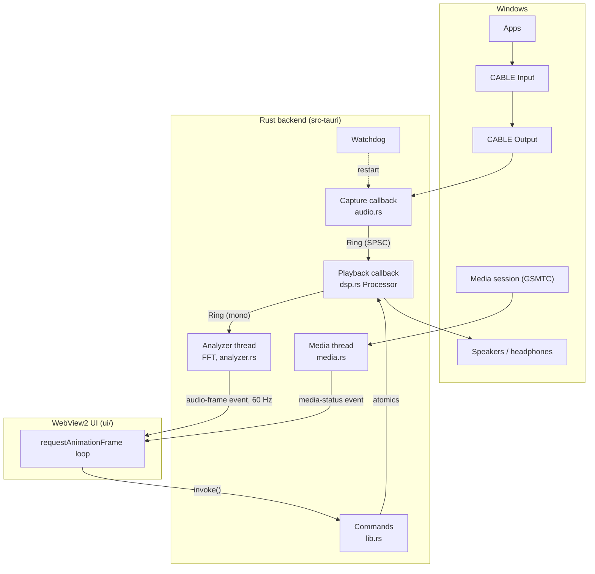

# SonicBoost architecture

This document explains how SonicBoost moves audio through the system, how the DSP works, and how the UI stays smooth.

- [Overview](#overview)
- [Threads](#threads)
- [Audio path](#audio-path)
- [DSP chain](#dsp-chain)
- [Now Playing](#now-playing)
- [UI](#ui)
- [Commands and events](#commands-and-events)
- [Settings](#settings)

---

## Overview



## Threads

| Thread | Owner | Job | Rules |
|:--|:--|:--|:--|
| **Capture callback** | WASAPI, through cpal | Converts the input to stereo f32, resamples if needed, and pushes into the ring | Lock-free, no allocation |
| **Playback callback** | WASAPI, through cpal | Pops from the ring, runs the DSP chain, writes the output and a mono copy for analysis | Lock-free, no allocation |
| **audio-engine** | `Engine::spawn` | Owns the `cpal::Stream`s (they aren't `Send`). Starts and stops on command. | Receives commands over an mpsc channel |
| **analyzer** | `spawn_analyzer` | Runs a 2048-point FFT every 16 ms and emits `audio-frame` | Sleeps while the window is hidden |
| **media-session** | `Media::spawn` | Polls the Windows media session every 500 ms and runs play/pause/next/previous | COM initialised as multithreaded (MTA) |
| **watchdog** | `spawn_watchdog` | Restarts the engine after a device error, falling back to the default output | Checks every 1.5 s |
| **main / UI** | Tauri | Commands, tray, hotkeys, window | Never touches audio buffers |

**Parameters** cross from the UI into the audio thread through `Params`, a set of atomics (`AtomicF32` stored as `u32` bits) plus a `version` counter. The playback callback re-reads them only when the version changes, so the hot path never takes a lock.

## Audio path

1. **Device selection.** The input is the saved device, or else the first device whose name contains `cable`, `virtual` or `voicemeeter`. The output is the saved device, or else the Windows default if it's a real device, or else the first non-virtual device. Choosing a virtual device as the output is refused, because it would loop.
2. **Format.** Each device uses its default shared-mode format. Sample formats f32, i16, i32 and u16 are converted to f32.
3. **Resampling.** If the input and output rates differ, a linear resampler converts the input to the output rate.
4. **Ring buffer.** A 1-second stereo SPSC ring separates the two device clocks. The playback side targets **25 ms** of buffered audio:
   - When the buffer runs dry, it outputs silence until it has refilled to the target (re-priming).
   - When the buffer grows past 4× the target, it skips back to the target, which corrects clock drift.
5. **Output.** Stereo goes to the first two channels. Mono devices get a mix. Any extra channels are filled with zeros.

## DSP chain

All processing is in `dsp.rs`, has no dependencies, and is unit-tested.

```
input → Pitch shifter → 10-band EQ → Width / Balance → Boost → Limiter → output
```

| Stage | Design |
|:--|:--|
| **Pitch** | A two-tap delay-line shifter (the "rotating tape head" design) with a ~42 ms window. Sin² crossfade windows always sum to 1. At a ratio of 1.0 it passes audio through untouched, with no added latency. The ratio glides. |
| **EQ** | RBJ cookbook biquads in transposed direct form II. Band 0 is a low shelf at 50 Hz, bands 1–8 are peaking filters (Q 1.1), and band 9 is a high shelf at 11.2 kHz. Every 32 samples the gains step 25 % of the way to their targets, which removes zipper noise. Bands at 0 dB are skipped. |
| **Width / Balance** | Mid/side width, `S × width`, followed by linear balance attenuation. Both glide. |
| **Boost** | Linear gain from 0 to 6 with a 30 ms glide. |
| **Limiter** | Stereo-linked peak limiter: threshold 0.94, instant attack, 120 ms release. It is followed by a tanh soft knee above 0.95, so the output can never exceed ±1. |

**Tests** (`cargo test --lib`) check that peaking and shelf filters hit their target gains, that a 12 dB boost measures 12 dB in the time domain, that pitch moves up one octave and down five semitones, that bypass is bit-exact, that 600 % boost never clips, that the EQ glides, that width and balance behave, the resampler ratio, the FFT peak bin, the ring buffer under contention, and the base64 and app-name helpers.

## Now Playing

`media.rs` uses `GlobalSystemMediaTransportControlsSessionManager`, the same source Windows uses for its volume-flyout media panel:

- **Metadata:** title, artist, album, and source app ID, mapped to a readable name.
- **Timeline:** position, start and end times. While playing, the position is advanced by the time elapsed since `LastUpdatedTime`.
- **Album art:** read through `DataReader`, base64-encoded and sent as a `data:` URL **only when the track changes**. The UI sends a `refresh` request when it opens so it always gets the art.
- **Controls:** `TryTogglePlayPauseAsync`, `TrySkipNextAsync` and `TrySkipPreviousAsync`.

## UI

Plain HTML, CSS and ES modules with no build step. Tauri serves `ui/` directly, and `withGlobalTauri` exposes the API.

| Module | Responsibility |
|:--|:--|
| `main.js` | State, wiring, the `requestAnimationFrame` loop, pausing when hidden |
| `audio-data.js` | Frame-rate-independent smoothing, peak caps with gravity, bass/mid/high energy, beat detection |
| `visualizer.js` | Canvas 2D visualizers (Bars, Radial, Wave, Galaxy) and the knob ring. Everything is clamped to the canvas. |
| `controls.js` | `Spring` (critically damped, sub-stepped at 240 Hz), the knob, pitch slider and EQ, plus the RBJ response curve in JS |
| `liquid.js` | A low-resolution blurred light field behind the glass, driven by the audio |
| `nowplaying.js` | Media card, art transitions, marquee, interpolated playhead |
| `bridge.js` / `mock.js` | The Tauri bridge, and a browser demo engine used when Tauri isn't present |

**Liquid glass.** Each panel has a `backdrop-filter: url(#liquid) blur() saturate()` (an SVG `feTurbulence` + `feDisplacementMap` refraction), a masked gradient rim, and a cursor-following specular highlight. Shadows come from one soft, layered scale (`--sh-xs/sm/md`).

## Commands and events

| Command | Arguments | Purpose |
|:--|:--|:--|
| `get_state` | — | Settings, engine status, autostart, devices |
| `set_boost` | `value` | Linear gain, 0–6 |
| `set_eq_band` / `set_eq` | `index, gain` / `gains, preset` | Equalizer |
| `set_pitch` | `semitones, cents` | Pitch |
| `set_stereo` | `width, balance` | Stereo image |
| `set_bypass` / `set_limiter` | `enabled` | Toggles |
| `set_devices` | `input, output` | Choose devices and restart the engine |
| `start_engine` / `stop_engine` | — | Engine control |
| `set_mode` | `mode` | Compact / extended (also resizes the window) |
| `set_ui` | `viz, theme, intensity` | UI preferences |
| `set_custom_presets` | `presets` | Saved presets |
| `set_autostart` / `set_start_minimized` | `enabled` | Startup behaviour |
| `set_viz_active` | `enabled` | Pause or resume the analyzer |
| `media_control` | `action` | `play_pause`, `next`, `previous`, `refresh` |
| `open_link` | `target` | Allow-listed links: Sound settings, VB-Cable page |

| Event | Payload |
|:--|:--|
| `audio-frame` | `{ bands[72], wave[256], peak_l, peak_r, rms }` |
| `media-status` | `{ available, title, artist, album, app, status, position, duration, art?, track_id }` |
| `engine-status` | `{ running, input, output, sample_rate, input_rate, latency_ms, error }` |
| `bypass-changed` / `boost-changed` | `bool` / `f32`, sent by the tray and hotkeys |

## Settings

Settings are stored in `%APPDATA%\dev.synclab.sonicboost\settings.json`. Every field has a default (`#[serde(default)]`), so older files load cleanly after an upgrade. On first run, `first_run` registers the app in Windows startup (`HKCU\…\Run`, through `tauri-plugin-autostart`) with the `--minimized` flag.
