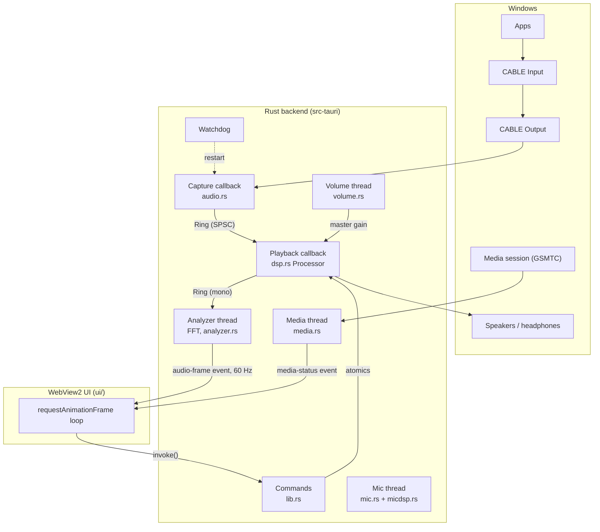

# SonicBoost architecture

This document explains how SonicBoost moves audio through the system, how the DSP works, and how the UI stays smooth.

- [Overview](#overview)
- [Threads](#threads)
- [Audio path](#audio-path)
- [DSP chain](#dsp-chain)
- [Windows volume](#windows-volume)
- [Mic](#mic)
- [Now Playing](#now-playing)
- [UI](#ui)
- [Commands and events](#commands-and-events)
- [Updates](#updates)
- [Settings](#settings)

---

## Overview



## Threads

| Thread | Owner | Job | Rules |
|:--|:--|:--|:--|
| **Capture callback** | WASAPI, through cpal | Converts the input to stereo f32, resamples if needed, and pushes into the ring | Lock-free, no allocation |
| **Playback callback** | WASAPI, through cpal | Pops from the ring, runs the DSP chain, writes the output and a mono copy for analysis | Lock-free, no allocation |
| **audio-engine** | `Engine::spawn` | Owns the `cpal::Stream`s (they aren't `Send`). Starts and stops on command. | Receives commands over an mpsc channel |
| **analyzer** | `spawn_analyzer` | Runs a 2048-point FFT every 16 ms and emits `audio-frame` | Sleeps while the window is hidden |
| **media-session** | `Media::spawn` | Polls the Windows media session every 500 ms and runs play/pause/next/previous | COM initialised as multithreaded (MTA) |
| **watchdog** | `spawn_watchdog` | Restarts the speaker or mic engine after a device error, falling back to the default output | Checks every 1.5 s |
| **windows-volume** | `volume::spawn` | Reads the default endpoint's master volume and mute, applies them as the final gain when the default output is a virtual cable, and emits `windows-volume` | Polls every 60 ms, COM MTA |
| **mic-engine** | `MicEngine::spawn` | Owns the mic capture, cable playback and monitor streams. Starts and stops on command. | Receives commands over an mpsc channel |
| **mic capture callback** | WASAPI, through cpal | Mono mix, resample to 48 kHz, 480-sample RNNoise frames, `MicChain`, push to the cable and monitor rings | `try_lock` only, no allocation |
| **mic-meters** | `spawn_meters` | Emits `mic-frame` at 30 Hz | Only while the Mic view is visible |
| **main / UI** | Tauri | Commands, tray, hotkeys, window | Never touches audio buffers |

**Parameters** cross from the UI into the audio thread through `Params`, a set of atomics (`AtomicF32` stored as `u32` bits) plus a `version` counter. The playback callback re-reads them only when the version changes, so the hot path never takes a lock.

## Audio path

1. **Device selection.** The input is the saved device, or else the first device whose name contains `cable`, `virtual` or `voicemeeter`. The output is the saved device, or else the Windows default if it's a real device, or else the first non-virtual device. Choosing a virtual device as the output is refused, because it would loop.
2. **Format.** Each device uses its default shared-mode format. Sample formats f32, i16, i32 and u16 are converted to f32.
3. **Resampling.** If the input and output rates differ, a linear resampler converts the input to the output rate.
4. **Ring buffer.** A 1-second stereo SPSC ring separates the two device clocks. The playback side targets **25 ms** of buffered audio:
   - When the buffer runs dry, it outputs silence until it has refilled to the target (re-priming).
   - When the buffer grows past 4× the target, it skips back to the target, which corrects clock drift.
5. **Output.** Stereo goes to the first two channels. Mono devices get a mix. Any extra channels are filled with zeros.

## DSP chain

All processing is in `dsp.rs`, has no dependencies, and is unit-tested.

```
input → Pitch shifter → Preamp → Parametric EQ (≤20 filters) → 10-band EQ → Ambience → Width / Balance → Boost → Loudness compressor → Limiter → × Windows volume → output
```

| Stage | Design |
|:--|:--|
| **Pitch** | A two-tap delay-line shifter (the "rotating tape head" design) with a ~42 ms window. Sin² crossfade windows always sum to 1. At a ratio of 1.0 it passes audio through untouched, with no added latency. The ratio glides. |
| **Parametric EQ** | Equalizer APO order: preamp, then up to 20 RBJ biquads (PK, LSC, HSC, LP, HP, NO, BP) with a user-set Q. Every 32 samples, frequency (geometric), gain and Q glide 25 % of the way to their targets. A type change or a newly added filter starts at its target with cleared state. The callback reads the configuration with `try_lock` only when `peq_version` changes, so it never waits and never allocates. |
| **EQ** | RBJ cookbook biquads in transposed direct form II. Band 0 is a low shelf at 50 Hz, bands 1–8 are peaking filters (Q 1.1), and band 9 is a high shelf at 11.2 kHz. Every 32 samples the gains step 25 % of the way to their targets, which removes zipper noise. Bands at 0 dB are skipped. |
| **Ambience** | Ping-pong multi-tap echo with low-passed feedback (recreates Equalizer APO reverb/echo scripts). Mix and room size glide. |
| **Width / Balance** | Mid/side width, `S × width`, followed by linear balance attenuation. Both glide. |
| **Boost** | Linear gain from 0 to 6 with a 30 ms glide. |
| **Loudness compressor** | Stereo-linked, threshold −16 dBFS with an 8 dB soft knee, 4 ms attack and 120 ms release. The ratio scales with the boost (1:1 at 100 %, 3.5:1 at 600 %), with full make-up gain, so quiet parts receive the whole boost while loud parts stay below the ceiling. |
| **Limiter** | Look-ahead peak limiter: the audio is delayed 5 ms, the gain computer holds the deepest reduction needed in that window, attack is tuned to complete within the look-ahead, release is 60 ms, threshold 0.93. A tanh soft knee above 0.95 follows, so the output can never exceed ±1. |

**Tests** (`cargo test --lib`) check that peaking and shelf filters hit their target gains, that a 12 dB boost measures 12 dB in the time domain, that pitch moves up one octave and down five semitones, that bypass is bit-exact, that 600 % boost never clips, that the EQ glides, that width and balance behave, the resampler ratio, the FFT peak bin, the ring buffer under contention, and the base64 and app-name helpers.

## Windows volume

Virtual cables ignore their own volume slider, so once Windows plays into the cable the taskbar slider would do nothing. `volume.rs` reads `IAudioEndpointVolume` on the default render endpoint (scalar level and mute). When that endpoint is a virtual cable and *Follow Windows volume* is on, the scalar is applied as the **last** multiply after the limiter, so the output is exactly `boosted sound × Windows volume`: Windows 100 % with boost 500 % gives 500 %, and Windows 50 % halves it. A test checks the scaling is exact.

## Mic

`mic.rs` runs a second, independent path: **mic → MicChain → second virtual cable** (for example VB-Audio Hi-Fi Cable), with an optional monitor output.

- **Devices.** `list_devices` lists inputs and outputs and suggests a cable that isn't the booster's. Cables are compared by driver name (`cable_family`), because VB-CABLE's *CABLE In 16ch* is a second input into the same cable as *CABLE Input*: using it would play your voice through the booster.
- **Capture.** Any channel count is mixed to mono and resampled to 48 kHz, then cut into 480-sample frames for RNNoise (`nnnoiseless::DenoiseState`, scaled to ±32768 and back).
- **Chain** (`micdsp.rs`, unit-tested): denoise → mic boost → gate (hysteresis + hold) → voice EQ preset → compressor → de-esser → voice mode (pitch shifter, mode EQ, ring modulator, comb, saturation, sample-and-hold, vibrato) → room → mute → soundboard mix (8 voices, `Arc` clips) → output level → limiter.
- **Output.** Mono is written to the first two channels of the cable. A 20 ms ring separates the device clocks, with the same re-priming and drift correction as the speaker path.
- **Parameters.** `MicShared` holds a `Mutex<MicParams>` plus a version counter; the callback re-reads with `try_lock` only when the version changes.
- **Test recorder.** Records 5 s of processed voice and plays it on the monitor device.
- **Presets.** `settings::builtin_mic_presets()` returns 8 complete chains; user presets live in `mic.presets`.

## Now Playing

`media.rs` uses `GlobalSystemMediaTransportControlsSessionManager`, the same source Windows uses for its volume-flyout media panel:

- **Metadata:** title, artist, album, and source app ID, mapped to a readable name.
- **Timeline:** position, start and end times. While playing, the position is advanced by the time elapsed since `LastUpdatedTime`.
- **Album art:** read through `DataReader`, base64-encoded and sent as a `data:` URL **only when the track changes**. The UI sends a `refresh` request when it opens so it always gets the art.
- **Controls:** `TryTogglePlayPauseAsync`, `TrySkipNextAsync` and `TrySkipPreviousAsync`.

## UI

Plain HTML, CSS and ES modules with no build step. Tauri serves `ui/` directly, and `withGlobalTauri` exposes the API.

| Module | Responsibility |
|:--|:--|
| `main.js` | State, wiring, the `requestAnimationFrame` loop, pausing when hidden |
| `mic.js` | The Mic view: presets, voice modes, chain, devices, soundboard, meters and waveform |
| `peq.js` | Parametric editor, APO / AutoEQ parser, GraphicEQ fitting, auto preamp |
| `select.js` | Themed glass drop-down that drives a hidden native `<select>` |
| `audio-data.js` | Frame-rate-independent smoothing, peak caps with gravity, bass/mid/high energy, beat detection |
| `visualizer.js` | Canvas 2D visualizers (Bars, Radial, Wave, Galaxy) and the knob ring. Everything is clamped to the canvas. |
| `controls.js` | `Spring` (critically damped, sub-stepped at 240 Hz), the knob, pitch slider and EQ, plus the RBJ response curve in JS |
| `liquid.js` | A low-resolution blurred light field behind the glass, driven by the audio |
| `nowplaying.js` | Media card, art transitions, marquee, interpolated playhead |
| `bridge.js` / `mock.js` | The Tauri bridge, and a browser demo engine used when Tauri isn't present |

**Liquid glass.** Each panel has a `backdrop-filter: url(#liquid) blur() saturate()` (an SVG `feTurbulence` + `feDisplacementMap` refraction), a masked gradient rim, and a cursor-following specular highlight. Shadows come from one soft, layered scale (`--sh-xs/sm/md`).

## Commands and events

| Command | Arguments | Purpose |
|:--|:--|:--|
| `get_state` | — | Settings, engine status, autostart, devices |
| `set_boost` | `value` | Linear gain, 0–6 |
| `set_eq_band` / `set_eq` | `index, gain` / `gains, preset` | Equalizer |
| `set_pitch` | `semitones, cents` | Pitch |
| `set_stereo` | `width, balance` | Stereo image |
| `set_bypass` / `set_limiter` | `enabled` | Toggles |
| `set_devices` | `input, output` | Choose devices and restart the engine |
| `start_engine` / `stop_engine` | — | Engine control |
| `set_mode` | `mode` | Compact / extended (also resizes the window) |
| `set_ui` | `viz, theme, intensity` | UI preferences |
| `set_custom_presets` | `presets` | Saved presets |
| `set_autostart` / `set_start_minimized` | `enabled` | Startup behaviour |
| `set_viz_active` | `enabled` | Pause or resume the analyzer |
| `media_control` | `action` | `play_pause`, `next`, `previous`, `refresh` |
| `set_peq` | `peq` | `{ enabled, preamp, filters: [{ enabled, kind, freq, gain, q }] }`, using APO type codes |
| `list_profiles` / `save_profile` / `apply_profile` / `delete_profile` | `name` | Sound profiles. `apply_profile` emits `state-reload` and rebuilds the tray menu |
| `check_update` | — | Latest GitHub release compared with the running version |
| `install_update` | `url` | Download the setup asset (this repo only), run it in passive mode, relaunch |
| `set_auto_update` | `enabled` | Check for updates on startup |
| `open_link` | `target` | Allow-listed links: Sound settings, VB-Cable page |
| `set_ambience` | `ambience` | `{ enabled, mix, size }` |
| `set_follow_volume` | `enabled` | Apply the Windows volume slider through the cable |
| `import_profiles` | `profiles` | Add or replace many profiles at once (APO file import) |
| `set_window_effect` | `theme` | Acrylic behind the window for the Glass theme |
| `mic_get` | — | Mic settings, status, devices, built-in presets and voice-mode codes |
| `mic_set` | `mic` | Save the whole mic config; restarts the mic engine only when devices or on/off change |
| `mic_mute` | `muted?` | Set or toggle mute |
| `mic_test` | `action` | `record` (5 s) or `play` |
| `mic_visible` | `enabled` | Stream mic meters only while the Mic view is open |
| `sb_add` / `sb_remove` / `sb_play` / `sb_stop` | `name, bytes` / `index` / `index` / — | Soundboard clips |

| Event | Payload |
|:--|:--|
| `audio-frame` | `{ bands[72], wave[256], peak_l, peak_r, rms }` |
| `media-status` | `{ available, title, artist, album, app, status, position, duration, art?, track_id }` |
| `engine-status` | `{ running, input, output, sample_rate, input_rate, latency_ms, error }` |
| `bypass-changed` / `boost-changed` | `bool` / `f32`, sent by the tray and hotkeys |
| `update-progress` | `{ done, total }` bytes while downloading an update |
| `state-reload` | profile name. The UI re-reads `get_state` and refreshes every control |
| `windows-volume` | `{ percent, muted, active }` |
| `mic-frame` | `{ running, input, output, gr_db, gate, voice, recording, wave[128] }` at 30 Hz |
| `mic-changed` | voice-mode code, `"muted"` / `"unmuted"`, or nothing. The UI re-reads `mic_get` |
| `mic-ptt` | `bool` while the push-to-talk key is held |
| `mic-status` | `{ running, input, output, monitor, latency_ms, error }` after a restart |

## Updates

`updater.rs` calls `GET /repos/fr4gout/SonicBoost/releases/latest`, compares `tag_name` with the app version (semver, where a pre-release ranks below the matching release), and picks the `*-setup.exe` asset. Downloads are allowed only from `https://github.com/fr4gout/SonicBoost/releases/download/…`, and the file is checked: it must be at least 500 KB, have the `MZ` header and match `Content-Length`. A hidden PowerShell process waits for `setup.exe /P` (passive mode) to finish, then relaunches the installed exe. The app saves its settings and exits first, so the installer can replace it.

## Settings

Settings are stored in `%APPDATA%\dev.synclab.sonicboost\settings.json`. Every field has a default (`#[serde(default)]`), so older files load cleanly after an upgrade. On first run, `first_run` registers the app in Windows startup (`HKCU\…\Run`, through `tauri-plugin-autostart`) with the `--minimized` flag.
