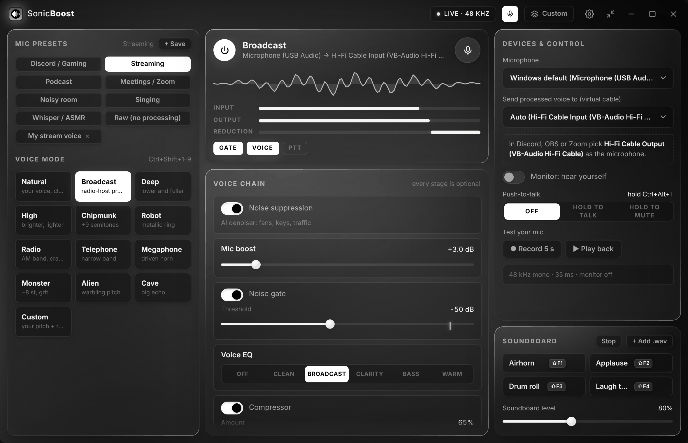
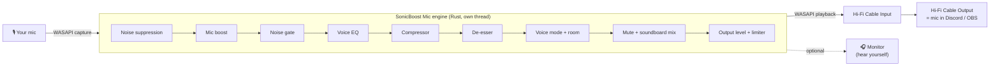

# SonicBoost Mic

A real-time microphone processor for Discord, games, OBS, Zoom and anything else that uses a mic. It cleans up your voice, adds **voice modes** and a **soundboard**, and appears to every app as an ordinary microphone.

Status: **built in v1.0.2.** Every part is optional: the mic system stays off until you press its power button, and each stage of the chain has its own switch.

  

---

## 1. How it plugs into Windows

Windows has no supported way for a normal app to change another app's microphone input, so the mic uses a virtual cable, the same approach SonicBoost uses for speakers. It needs a **second** cable, so the booster keeps its own:

| Path | Device | Used by |
|:--|:--|:--|
| Speakers | Windows output → **CABLE Input** → CABLE Output → SonicBoost → speakers | the booster |
| **Mic** | your mic → SonicBoost Mic → **Hi-Fi Cable Input** → **Hi-Fi Cable Output** | Discord / OBS / games choose **Hi-Fi Cable Output** as their microphone |

Any second, separate cable works: VB-Audio **Hi-Fi Cable** (free) or **CABLE A+B**. SonicBoost picks one automatically and refuses every end of the cable the booster records, so the two paths can never loop into each other.

> **Not CABLE In 16ch.** VB-CABLE installs two inputs, *CABLE Input* and *CABLE In 16ch*, but they feed the **same** CABLE Output. Sending your voice there plays it through the booster to your speakers, so SonicBoost won't use it for the mic.

The speaker and mic paths are independent threads with their own buffers, so mic processing never touches the music path, and the reverse.

### Setup in 3 steps
1. Install a second, separate virtual cable (VB-Audio **Hi-Fi Cable** or **CABLE A+B**), then restart.
2. Open SonicBoost, click the **🎙 Mic** button in the title bar, and press the power button.
3. In Discord / OBS / Zoom, choose the output side of your second cable (for example **Hi-Fi Cable Output**) as the microphone. The Mic view shows the exact name to pick.

---

## 2. Features

### Voice chain (every stage optional)
| Stage | What it does | How |
|:--|:--|:--|
| **Noise suppression** | Removes fans, keyboard, traffic and hum, while keeping your voice | RNNoise neural denoiser (`nnnoiseless`, pure Rust, 10 ms frames at 48 kHz) |
| **Mic boost** | Quiet mics become loud | 0 to +24 dB |
| **Noise gate** | Silent between words | Threshold −80 to −10 dB with hysteresis and hold, so it never chatters. A marker on the slider shows your live input level. |
| **Voice EQ** | Tone presets | Off, Clean (80 Hz high-pass), Broadcast, Clarity, Bass voice, Warm |
| **Compressor** | Keeps your level steady whether you whisper or shout | Amount 0–100 %, with automatic make-up gain |
| **De-esser** | Tames harsh "s" sounds | A band compressor around 6–8 kHz, amount 0–100 % |
| **Limiter** | No clipping, even when you shout | Look-ahead peak limiter |
| **Output level** | Final level into the cable | −24 to +12 dB |

### Mic presets
One click sets the whole chain. Presets keep your current voice mode.

| Preset | Built for |
|:--|:--|
| **Discord / Gaming** | Clean voice, steady level, gate at −45 dB |
| **Streaming** | +3 dB, Broadcast EQ, stronger compression, de-esser |
| **Podcast** | Broadcast EQ, heavy compression, de-esser |
| **Meetings / Zoom** | Clarity EQ, light compression |
| **Noisy room** | Tighter gate (−38 dB) with suppression |
| **Singing** | No gate or suppression, Warm EQ, gentle compression |
| **Whisper / ASMR** | +12 dB, low gate, Bass voice EQ, heavy compression |
| **Raw (no processing)** | Everything off |

Click **+ Save** to keep your own chain as a preset (up to 30). Hover a saved preset and click × to delete it.

### Voice modes (voice changer)
Switch with a click or <kbd>Ctrl</kbd>+<kbd>Shift</kbd>+<kbd>1</kbd>…<kbd>9</kbd> (the first nine modes, in this order).

| Mode | Sound | Built from |
|:--|:--|:--|
| **Natural** | Just clean-up | — |
| **Broadcast** | Radio-host voice: deep and close | Low shelf +4 dB, presence +3 dB |
| **Deep** | Lower, bigger voice | Pitch −4 st and a low-shelf lift |
| **High** | Brighter, lighter | Pitch +5 st |
| **Chipmunk** | Cartoon high | Pitch +9 st |
| **Robot** | Metallic robot | 50 Hz ring modulator and a comb filter |
| **Radio** | Walkie-talkie | Band-pass 300 Hz – 3 kHz with light saturation |
| **Telephone** | Old phone line | Band-pass 400 Hz – 3.4 kHz with lo-fi sample-and-hold |
| **Megaphone** | Loudspeaker | Mid boost, driven saturation and a short slap echo |
| **Monster** | Huge, growly | Pitch −8 st, low shelf and grit |
| **Alien** | Wobbly, otherworldly | Pitch +3 st with vibrato and a ring modulator |
| **Cave** | Big room | The Ambience echo tuned for voice |
| **Custom** | Your own | Your pitch (±12 st) and room amount |

### Monitoring and control
- **Monitor (hear yourself)** on any output, with its own volume. Use headphones to avoid feedback.
- **Mute** button and <kbd>Ctrl</kbd>+<kbd>Alt</kbd>+<kbd>M</kbd>. Soundboard clips still play while you're muted.
- **Push-to-talk / push-to-mute:** hold <kbd>Ctrl</kbd>+<kbd>Alt</kbd>+<kbd>T</kbd>. A PTT light shows when it's held.
- **Test your mic:** records 5 seconds of the processed voice and plays it back on the monitor device.
- **Meters:** input, output and gain reduction, live Gate and Voice lights, and a waveform.

### Soundboard
- Add up to 16 `.wav` clips (8, 16, 24 or 32-bit PCM or float, any sample rate, mono or stereo). A copy is kept in the app folder.
- Clips play **into the mic stream**, mixed with your voice, so everyone in the call hears them. Up to 8 play at once.
- The first 8 clips get hotkeys: <kbd>Ctrl</kbd>+<kbd>Shift</kbd>+<kbd>F1</kbd>…<kbd>F8</kbd>. **Stop** silences them all.
- Its own level slider (0–200 %).

---

## 3. Latency and quality

| | Value |
|:--|:--|
| Added latency (mic → apps) | about 35 ms (10 ms denoiser frames + a 20 ms buffer + device) |
| Format | 48 kHz mono internally, written to the first two channels of the cable |
| Safety | Never clips (limiter); the mic can't be sent into the booster's own cable |
| Efficiency | Meters stream only while the Mic view is open |
| Recovery | The watchdog reopens the mic after a device is unplugged or changes |

## 4. UI

A **🎙 Mic** button in the title bar switches between the booster and the Mic view. The choice is remembered.

- **Extended:** presets and voice modes on the left, meters and the voice chain in the centre, devices, monitor, push-to-talk, the mic test and the soundboard on the right.
- **Compact:** meters and the mute button, scrollable preset and mode rows, the voice chain and the soundboard. The ⚙ button opens devices and control as a sheet.

## 5. Tests

`micdsp.rs` is unit-tested (`cargo test --lib`): the gate silences noise but passes voice, the compressor evens out loud and quiet speech, the de-esser reduces sibilance without touching the voice, every voice mode is stable and clip-free, Deep and Chipmunk really shift the pitch, mute and the soundboard mix behave (including freeing a slot when a clip ends), and a WAV file survives a round trip and is resampled to 48 kHz.
